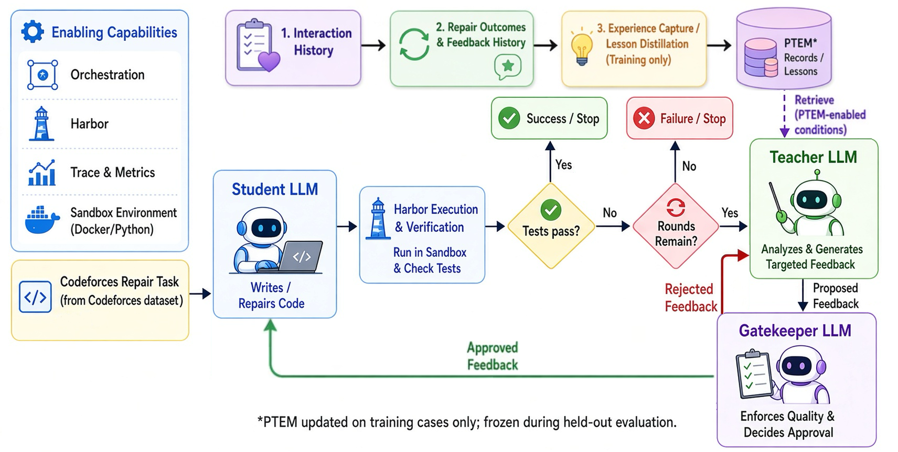
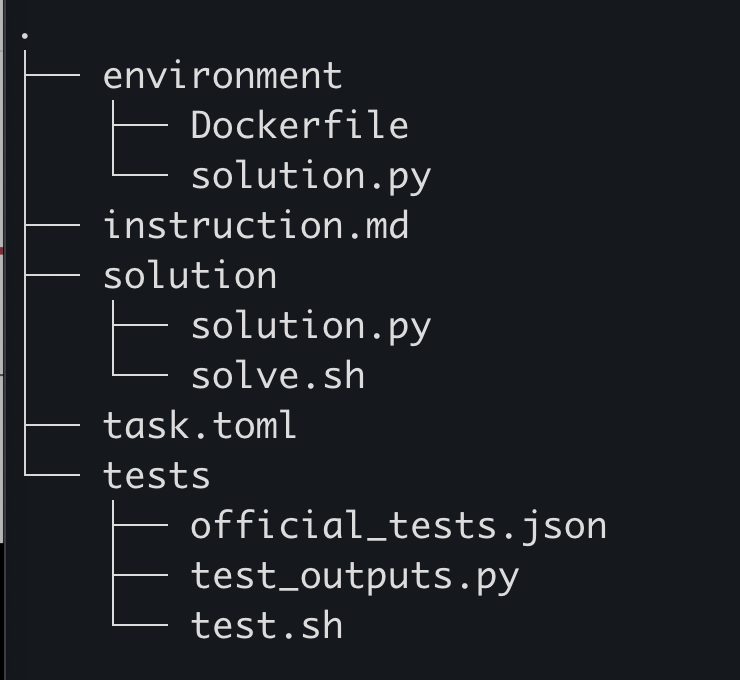

# Tagent A1 midpoint prototype

This repository is the midpoint prototype for the Tagent A1 code-repair study. A small language model receives a Codeforces statement and a Python 3 program that Codeforces already rejected, and it must return a repaired program. Harbor then grades that program on the official tests. The model does not see those tests, and it does not see an accepted solution.



The stored dataset is the 459 problems Qwen3-Coder solved from the public statement, and the 168,715 Python 3 submissions to those problems. They are partitioned by problem into Train (229), Dev (123), and Test (107). The notes in `data/clean/` explain the cut, the columns, and the commands.

What you can run here:

- the offline checks and the dataset summary, with no API key and no Docker
- one language-model repair of the example task, with Docker and an OpenRouter key
- the same repair on all three included tasks, for each of the three small models or for Qwen3-Coder

Replaying the full Train, Dev, and Test jobs is not part of this checkout. Those jobs are thousands of trials. Their scores are already in `data/example_code/harbor_jobs/`.

## Requirements

- Python 3.12
- [uv](https://docs.astral.sh/uv/)
- Docker, running, for a Harbor trial
- An API key, only for a live model call

## Clone the repository

```bash
git clone git@github.com:chesnay/CS329Z_midway.git
cd CS329Z_midway
```

Run every later command from that directory. If you already have this checkout, skip the clone.

## Add an API key

The example task and the model commands below call OpenRouter and spend API credits. Reading the dataset does not. Copy the template and set `OPENROUTER_API_KEY`:

```bash
cp .env.example .env
```

`.env` is listed in `.gitignore`. Do not commit it.

The template also has `GEMINI_API_KEY`. A Gemini key does not run the OpenRouter model ids in this repository. Leave it blank unless you point Harbor at a Gemini model yourself. Get an OpenRouter inference key from <https://openrouter.ai/keys>. Harbor loads `.env` only when you pass `--env-file`.

## Set up Docker

Follow the installation instructions for your operating system.

- [Mac installation](https://docs.docker.com/desktop/setup/install/mac-install/)
- [Linux installation](https://docs.docker.com/engine/install/ubuntu/)

Once it is installed, take some time to make sure you understand Docker and these terms:

- A Dockerfile is the text recipe for an image. Each task has one at `environment/Dockerfile`. The demo tasks start from `python:3.12-slim-bookworm` and copy the rejected program to `/app/solution.py`.
- An image is the built snapshot. `ubuntu:22.04` is one image. The image built from a task Dockerfile is another.
- A container is one running instance of an image. Harbor starts a container for each attempt, runs the agent in it, then runs the verifier.

Pull the `ubuntu:22.04` image. That download checks that Docker can fetch an image. The demo tasks do not use this image. Harbor builds their image from `environment/Dockerfile` when you run a task.

```bash
docker pull ubuntu:22.04
```

## Install Harbor and check that Docker answers

From this repository, install the pinned dependencies and inspect Harbor's command-line interface:

```bash
uv sync
uv run harbor --version
uv run harbor --help
docker version
```

`uv sync` installs Harbor 0.18.0 and the libraries used to read the Parquet tables. Check that `harbor --version` prints a version, and that `docker version` prints both a Client section and a Server section. The Server section means the Docker client can reach the Docker server. If it is missing, start Docker and run `docker version` again.

In `harbor --help`, `run` starts an evaluation job and `view` browses finished results. Do not start an evaluation until the example task below.

## Read the dataset and the reported scores

No key and no Docker. The first command checks the code. The second summarizes every split. The third lists the Train problems. The fourth lists the submissions for one problem. The fifth prints that problem's small-model scores.

```bash
uv run pytest
```
`pytest` checks the formula repair and the rule that keeps a problem only when Qwen3-Coder passed.

```bash
uv run python scripts/summarize_clean_codeforces.py
```
`summarize_clean_codeforces.py` prints the dataset counts and the small-model results for Train, Dev, and Test.

```bash
uv run python scripts/list_clean_codeforces.py --split train
```
`list_clean_codeforces.py --split train` lists every Train problem. Use `dev` or `test` for the other splits. Each line has the id, rating, number of official tests, number of submissions, number accepted, and one cell per small model.

```bash
uv run python scripts/list_clean_codeforces.py --split dev --problem 26/A
```
`list_clean_codeforces.py --split dev --problem 26/A` lists that problem's submissions: the submission id, the Codeforces verdict, and how many tests Codeforces counted as passed. It does not print the program. Add `--source 101817015` to print that one program. The id has to belong to the problem.

```bash
uv run python scripts/show_clean_runs.py --split dev --problem 26/A
```

`show_clean_runs.py --split dev --problem 26/A` prints only the small-model scores for that problem. Leave out `--problem` to print the whole split.

A cell such as `2/5` means two of five attempts passed. `not run` means that problem was not given to the small models.

On the clean Train set, 224 of 229 problems were run, five attempts each at temperature 0.7, with the teacher line "try again":

| Model | OpenRouter id | Problems solved | Passing trials |
| --- | --- | --- | --- |
| Llama 3.2 1B | `openrouter/meta-llama/llama-3.2-1b-instruct` | 12/224 | 18/1120 |
| Ministral 3B | `openrouter/mistralai/ministral-3b-2512` | 86/224 | 218/1120 |
| Llama 3.2 3B | `openrouter/meta-llama/llama-3.2-3b-instruct` | 32/224 | 61/1120 |

Five Train problems were left out of those runs. `195/B` would have shown a hidden expected output in the prompt. `177/A1`, `236/B`, `544/A`, and `1298/C` already had a starter that passed. The same three models were also run on Dev (121 of 123 problems) and Test (106 of 107). The summary script prints those counts too.

The score files are `result.json` inside each `data/example_code/harbor_jobs/<job>/` directory, plus `rest_train_summary.json`, `solved158_summary.json`, `heldout_dev_summary.json`, and `heldout_test_summary.json`. The per-trial logs are not in this repository. A command below writes its own log on your machine. Harbor resumes a finished job when the `--job-name` already exists, so use a new name for a new attempt. Do not commit those logs.

## Run the example task

The example is Codeforces 630/A, "Again Twenty Five!", starting from rejected submission 230389330. It is the smallest of the three included tasks. `630/C` and `825/A` use the same layout.

First, inspect each component of `data/example_code/harbor_tasks/demo/train/630_A__230389330` to understand the structure of the program:



```text
630_A__230389330/
  task.toml                  metadata, the split, and the time limits
  instruction.md             statement, samples, the verdict, and "try again"
  environment/Dockerfile     builds the container the agent starts in
  environment/solution.py    the rejected program, copied to /app/solution.py
  tests/test.sh              verifier entry point
  tests/test_outputs.py      grades the program on the official tests
  tests/official_tests.json  the official tests; the agent does not see this file
  solution/solve.sh          reference solution, used only by the oracle
  solution/solution.py       one accepted program, copied in by solve.sh
```

The agent sees `instruction.md` and `environment/`. The verifier sees `tests/` only after the agent stops. A model call does not read `solution/`.

The 459-problem tables do not contain a Harbor oracle. They contain the statement, the official tests, and the Python 3 submissions. Every problem in those tables has at least one submission Codeforces accepted. That accepted program is a row in `submissions/`, not a `solution/solve.sh` wired up for Harbor. Only the three demo tasks include `solution/solve.sh`. Grading a model does not need that file. Harbor grades whatever program is at `/app/solution.py` against `tests/`.

Run one language-model attempt on this task. It spends OpenRouter credits. Llama 3.2 1B is the smallest of the three student models.

```bash
PYTHONPATH=src uv run harbor run \
  --path data/example_code/harbor_tasks/demo/train/630_A__230389330 \
  --agent tagent.agents.rewrite_student:RewriteStudent \
  --model openrouter/meta-llama/llama-3.2-1b-instruct \
  --env-file .env \
  --yes \
  --n-attempts 1 \
  --agent-kwarg temperature=0.7 \
  --job-name demo__llama-3.2-1b__630a \
  --jobs-dir data/example_code/harbor_jobs
```

`PYTHONPATH=src` is required. Harbor imports `tagent.agents.rewrite_student:RewriteStudent` from this repository, and that package is not installed into the environment. The agent asks the model for a complete Python 3 program, writes it to `/app/solution.py`, and stops. Harbor then runs `tests/test_outputs.py`. A reward of `1` means every official test passed. The log is `data/example_code/harbor_jobs/demo__llama-3.2-1b__630a/`, and the per-trial file `verifier/reward.txt` is `1` or `0`. A reward of `0` on this model is a normal outcome, not a broken install.

Browse that log, and the saved score files, on your own machine:

```bash
uv run harbor view data/example_code/harbor_jobs
```

Open the address it prints, usually `http://127.0.0.1:8080`. Stop the viewer with Ctrl-C.

The three demo tasks do include an accepted program, so you can grade that program without calling a model. `--agent oracle` runs `solution/solve.sh`, which copies `solution/solution.py` over `/app/solution.py`, and then the same tests run. Use `--job-name demo-oracle`. That check does not read `.env`. It is not available for the other 456 problems, because those problems were not exported as Harbor tasks.

## Run a model on the three tasks

Use the `.env` created above. It must contain `OPENROUTER_API_KEY`. Start Docker. Each command below runs one model on the three included tasks, Codeforces `630/A`, `630/C`, and `825/A`. Each task starts from a rejected Python 3 submission. The teacher line in the instruction is "try again".

`PYTHONPATH=src` is required on every command. Harbor imports `tagent.agents.rewrite_student:RewriteStudent` from this repository, and that package is not installed into the environment. The agent asks the model for a complete Python 3 program, writes it to `/app/solution.py`, and stops. Harbor then runs `tests/test_outputs.py`. A later file `verifier/reward.txt` is `1` when every official test passes and `0` otherwise.

One attempt at temperature 0.7 is enough to see the prototype. The reported small-model rates used five attempts. Give every run its own `--job-name`. Reusing a name resumes the old job.

### Llama 3.2 1B

```bash
PYTHONPATH=src uv run harbor run \
  --path data/example_code/harbor_tasks/demo/train \
  --agent tagent.agents.rewrite_student:RewriteStudent \
  --model openrouter/meta-llama/llama-3.2-1b-instruct \
  --env-file .env \
  --yes \
  --n-attempts 1 \
  --agent-kwarg temperature=0.7 \
  --job-name demo__llama-3.2-1b \
  --jobs-dir data/example_code/harbor_jobs
```

Expect this model to fail these problems. That is the usual outcome in the table above, not a broken install.

### Ministral 3B

```bash
PYTHONPATH=src uv run harbor run \
  --path data/example_code/harbor_tasks/demo/train \
  --agent tagent.agents.rewrite_student:RewriteStudent \
  --model openrouter/mistralai/ministral-3b-2512 \
  --env-file .env \
  --yes \
  --n-attempts 1 \
  --agent-kwarg temperature=0.7 \
  --job-name demo__ministral-3b \
  --jobs-dir data/example_code/harbor_jobs
```

### Llama 3.2 3B

```bash
PYTHONPATH=src uv run harbor run \
  --path data/example_code/harbor_tasks/demo/train \
  --agent tagent.agents.rewrite_student:RewriteStudent \
  --model openrouter/meta-llama/llama-3.2-3b-instruct \
  --env-file .env \
  --yes \
  --n-attempts 1 \
  --agent-kwarg temperature=0.7 \
  --job-name demo__llama-3.2-3b \
  --jobs-dir data/example_code/harbor_jobs
```

### Qwen3-Coder

Qwen3-Coder is the large coding model that selected the 459 problems. On those problems it saw the public statement only, with up to three tries at temperature 0.7, and no rejected program. This checkout cannot replay that selection. The command below uses the same Harbor agent as the small models, so on these three tasks the model also sees the rejected submission and the line "try again". The Harbor model id adds the `openrouter/` prefix to the catalog id `qwen/qwen3-coder`.

```bash
PYTHONPATH=src uv run harbor run \
  --path data/example_code/harbor_tasks/demo/train \
  --agent tagent.agents.rewrite_student:RewriteStudent \
  --model openrouter/qwen/qwen3-coder \
  --env-file .env \
  --yes \
  --n-attempts 1 \
  --agent-kwarg temperature=0.7 \
  --job-name demo__qwen3-coder \
  --jobs-dir data/example_code/harbor_jobs
```

This model is larger than the three above, so one attempt on three tasks costs more. Raise `--n-attempts` to 3 to match the selection protocol, and use a new `--job-name` if `demo__qwen3-coder` has already run.

## What a task contains

| Path | Who sees it |
| --- | --- |
| `instruction.md` | the student: statement, samples, the rejected submission's verdict, and "try again" |
| `environment/solution.py` | the student, as `/app/solution.py`: the rejected program |
| `tests/` | the verifier, after the model stops: the official tests |
| `solution/solution.py` | Harbor's oracle only: one accepted program, not shown to the student |

## Harbor logging the experiments
A Harbor run writes data/example code/harbor jobs/<job-name>/result.json
and, inside each trial, `verifier/reward.txt`. That file is 1 when every official test passed
and 0 otherwise. The terminal table reports the same reward. A reward of 0 for Llama 3.2 1B on
these problems is a normal outcome, not a failed installation. The reference-solution run on 630/A
should report a reward of 1.0. Finished logs can be browsed with uv run harbor view
data/example code/harbor jobs, which serves a page on <http://127.0.0.1:8080>.
The per-trial logs of the original study are not in the repository. A new run writes its own log locally.
Do not commit that log.

```bash
uv run harbor view data/example_code/harbor_jobs
```

## What this checkout does not rerun

`scripts/run_rest_train.py` is the program that built the full jobs in the original repository. It reads case files, split lists, and the unfiltered official subset, and it calls Qwen3-Coder before the small models. Those inputs are not here. Do not use it to reproduce the table.

`data/example_code/export_harbor_task.py` writes a new Harbor task from that same official subset. The three demo tasks were exported there and copied here. Exporting a different problem needs the subset, which is not in this repository. The statements and tests for the 459 problems are in `data/clean/` and can be read with the commands above.

## Layout

```text
.env.example                                key names only; copy to .env
src/tagent/agents/rewrite_student.py        the student Harbor runs
src/tagent/data/                            loaders and the formula repair
data/clean/                                 problems, submissions, and the notes
data/example_code/harbor_tasks/demo/        three tasks ready to run
data/example_code/harbor_jobs/              saved scores, not the trial logs
scripts/                                    summary, listing, and the run record
tests/                                      offline checks
```
